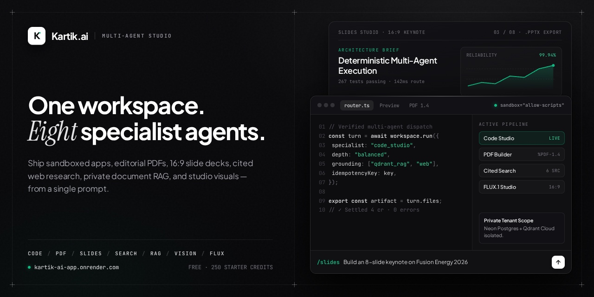

<div align="center">



# Kartik.ai — Multi-Agent AI Workspace

**Live App: [https://kartik-ai-app.onrender.com/](https://kartik-ai-app.onrender.com/)**

[](https://kartik-ai-app.onrender.com/)
[](https://www.typescriptlang.org/)
[](https://react.dev/)
[](https://nodejs.org/)
[](#verification--testing)

Build **live interactive code apps**, **editorial multi-page PDF reports**, **16:9 PowerPoint (`.pptx`) slide decks**, **cited real-time web research**, **private PDF RAG Q&A**, **multimodal vision analysis**, and **FLUX.1 studio images** inside one unified multi-agent AI studio.

</div>

---

## Live Workspace

Try **Kartik.ai** immediately — no credit card required (every workspace starts with **250 free credits**):

- **Production URL:** [https://kartik-ai-app.onrender.com/](https://kartik-ai-app.onrender.com/)
- **Google Sign-In:** Powered by Firebase Authentication (`kartik-ai-app`) with isolated guest workspaces and instant sign-in hydration.

---

## Specialist AI Agents & Studio Capabilities

Kartik.ai combines a **unified Chat Smart Hub** (automatic intent routing) with **7 direct specialist modes** accessible via slash commands (`/code`, `/pdf`, `/slides`, `/search`, `/rag`, `/vision`, `/image`) or the composer selector:

| Specialist | What It Builds | Key Features |
|---|---|---|
| **Chat & Smart Router** | Structured answers, analysis, math & diagrams | Automatic specialist routing, Concise / Balanced / Deep response modes, LaTeX math, Mermaid diagrams, GFM tables with CSV export & sorting |
| **Code Studio** | Live multi-file HTML, CSS, JS & React apps | Opaque-origin `iframe sandbox="allow-scripts"` live preview, multi-file editor, syntax highlighting, line diff viewer, standalone HTML & ZIP export |
| **PDF Builder** | Native multi-page `%PDF-1.4` editorial reports | Domain-universal document layout engine with tables, metrics, callouts, live editorial preview, Markdown export & binary `.pdf` download |
| **Slides Studio** | Custom 16:9 PowerPoint (`.pptx`) keynote decks | Editable 8-slide interactive deck preview, light/dark theme toggle, speaker notes, cover visual recompile, printable PDF handout & `.pptx` export |
| **Cited Web Search** | Up-to-date grounded web research | Live Gemini Search Grounding with inline clickable citations (`[1]`, `[2]`) and verified source previews |
| **Private PDF RAG** | Grounded multi-turn document Q&A | Attach PDFs (up to 25 pages / 10 MB), private per-user chunking & vector search in Qdrant Cloud with strict conversation & tenant scoping |
| **Multimodal Vision** | Image inspection & follow-up Q&A | Private ownership-scoped image uploads streamed via signed/authenticated endpoints with multi-turn visual reasoning |
| **Image Studio** | High-resolution 16:9 studio artwork | Live **Cloudflare Workers AI (`@cf/black-forest-labs/flux-1-schnell`)** generation with prompt inspection, PNG download & automatic credit refunds on failure |

---

## Production Architecture & Tech Stack

| Layer | Technology |
|---|---|
| **Frontend (`@kartik/frontend`)** | React 19, TypeScript (strict), Tailwind CSS v4, Motion primitives, lazy-loaded Studio panels (`ArtifactPanel`, `SlideDeckPreview`, `PdfDocumentPreview`, `BillingDrawer`, `CommandPalette`), sticky `Idempotency-Key` API client |
| **Backend & Services** | Full-stack Express + Vite platform runtime (`server.ts`) backed by modular workspaces (`@kartik/gateway`, `@kartik/auth`, `@kartik/chat`, `@kartik/agent`, `@kartik/billing`, `@kartik/shared`) |
| **Primary Database & Object Storage** | **Neon PostgreSQL** (`Drizzle ORM` + `pg` pool) with `private_objects` binary storage (`OBJECT_STORAGE_MODE=neon`) and HMAC-signed private download URLs |
| **Vector Search (RAG)** | **Qdrant Cloud** (`gemini-embedding-2` vectors, strict per-user & per-conversation payload filters) |
| **Cache & Rate / Budget Guard** | **Upstash Redis** (`rediss://` TLS) with automatic resilient circuit-breaker fallback |
| **AI Models** | **Google Gemini** (`gemini-3.1-flash-lite` + Search Grounding + `gemini-embedding-2`) and **Cloudflare Workers AI** (`@cf/black-forest-labs/flux-1-schnell`) |
| **Authentication & Multi-Tenancy** | **Firebase Auth** (Google Sign-In + Admin SDK `cert` verification), `HttpOnly; Secure; SameSite` session cookies, strict zero-cross-tenant isolation |
| **Billing & Credit Ledger** | **Razorpay (Test Mode)**, integer-paise server-side pricing (`planId`-only checkout), two-phase `Reserve -> Execute -> Settle/Release` credit accounting, SHA-256 idempotency replay protection |
| **Deployment & SEO** | **Render** (multi-stage Node 22 Docker), dynamic `/robots.txt`, `/sitemap.xml`, `/site.webmanifest`, multi-size PNG/ICO/SVG favicons, `1376×768` OpenGraph card, and Schema.org JSON-LD (`WebApplication`, `WebSite`, `Organization`) |

---

## Security & Reliability Highlights

- **Verified Auth Only:** Never trusts caller-supplied UID/email or unverified JWT payloads; every authenticated request is verified via Firebase Admin SDK or signed server-side sessions.
- **Strict Tenant Isolation:** Every conversation, uploaded file, Qdrant vector chunk, private Neon object, and billing ledger record is scoped strictly to the owning user (`404` on cross-tenant access).
- **Idempotent Two-Phase Billing:** Client-owned `Idempotency-Key` headers with SHA-256 payload conflict detection (`409`) and automatic credit refund on upstream provider failure.
- **Sandboxed Code Execution:** Generated web apps render inside opaque-origin `iframe sandbox="allow-scripts"` (never `allow-same-origin`) with strict CSP and `</script>` breakout protection.
- **Crawl & Header Hygiene:** `X-Robots-Tag: noindex, nofollow` on `/api/*`, true `404` responses on missing static assets (preventing Soft-404s), `X-Content-Type-Options: nosniff`, and dev-only download routes hard-disabled in production.

---

## Local Quickstart

### Prerequisites
- **Node.js `>=22`** and **npm / pnpm**
- Optional live providers: Neon PostgreSQL, Upstash Redis, Qdrant Cloud, Gemini API key, Cloudflare Workers AI token, Firebase project, Razorpay Test keys (all documented in [`.env.example`](.env.example)).

### Run Locally

```bash
# 1. Clone the repository
git clone https://github.com/KratX/kartik-ai.git
cd kartik-ai

# 2. Install dependencies
npm install --include=dev --legacy-peer-deps

# 3. Configure environment variables
cp .env.example .env
# Fill in your provider keys in .env (or leave MOCK_AI=true for offline testing)

# 4. Validate environment configuration
npm run check:env

# 5. Start the full-stack server on http://localhost:3000
npm run dev
```

### Deploy to Render

This repository includes a production-ready [`Dockerfile`](Dockerfile) and [`render.yaml`](render.yaml):

1. Connect your GitHub repository in **Render → New Web Service** (Docker runtime, health check `/healthz`).
2. Add your production environment variables in **Render → Environment** (never commit `.env`).
3. Authorize your Render hostname in **Firebase Console → Authentication → Settings → Authorized domains**.

---

## Verification & Testing

The repository is backed by **267 automated tests** across unit, security, multi-user isolation, and SEO suites:

```bash
# Core workspace unit & service tests (49 suites, 245 tests)
npm test

# Multi-user isolation, Firebase auth, idempotency, RAG & Razorpay integration tests (13 tests)
npx tsx --test src/server/platform-multi-user-isolation.test.ts

# SEO, canonical origin, sitemap, robots.txt, manifest & JSON-LD tests (9 tests)
npx tsx --test src/server/seo.test.ts

# Typecheck & architectural lint across all workspaces
npm run lint
```

---

## Project Structure

```text
kartik-ai/
├── server.ts                  # Full-stack Express + Vite / production dist server
├── index.html                 # Canonical SEO, OpenGraph, icons & JSON-LD entry
├── Dockerfile                 # Multi-stage Node 22 production container
├── render.yaml                # Render Blueprint deployment spec
├── public/                    # Favicon suite (.ico, .svg, 48/180/192/512 PNG) & og-image.jpg
├── src/
│   ├── db/                    # Drizzle ORM schema, Neon Postgres & private object storage
│   ├── lib/                   # Firebase Admin SDK (service-account cert) & client helpers
│   ├── middleware/            # Verified Firebase auth, session & isolated guest cookies
│   └── server/                # Multi-agent platform runtime, SEO helpers & integration tests
├── frontend/                  # @kartik/frontend React 19 UI, studios & sandbox preview
├── backend/
│   ├── gateway/               # @kartik/gateway public API front door
│   ├── shared/                # @kartik/shared config, errors, Redis, DB & Ed25519 helpers
│   └── services/              # @kartik/auth, @kartik/chat, @kartik/agent, @kartik/billing
└── docs/                      # Architecture overview, OpenAPI 3.1 spec, ADRs & runbooks
```

---

## Documentation

| Document | Description |
|---|---|
| [`docs/architecture/overview.md`](docs/architecture/overview.md) | Services, ownership boundaries, request flow, and non-negotiables |
| [`docs/api/openapi.yaml`](docs/api/openapi.yaml) | Public OpenAPI 3.1 specification |
| [`docs/decisions/`](docs/decisions/) | Architecture Decision Records (`0000`–`0004`) |
| [`docs/COST.md`](docs/COST.md) | Free-tier provider budgets and guardrail policy |
| [`docs/PORTFOLIO.md`](docs/PORTFOLIO.md) | Key engineering trade-offs and design decisions |
| [`docs/runbooks/`](docs/runbooks/) | Local development, deployment, rollback, and teardown guides |

---

<div align="center">

Built by **[Kartik Rawat](https://github.com/KratX)** · Try it live at **[kartik-ai-app.onrender.com](https://kartik-ai-app.onrender.com/)**

</div>
